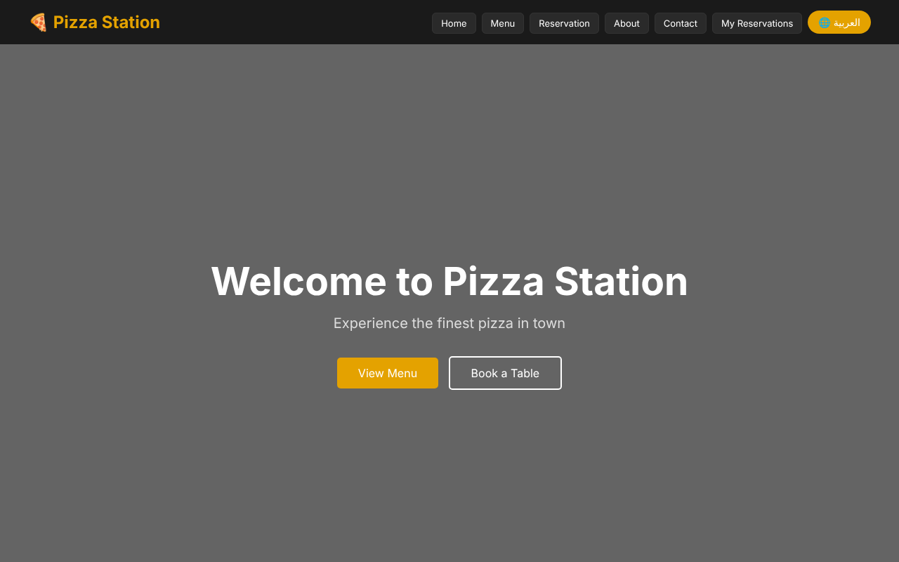
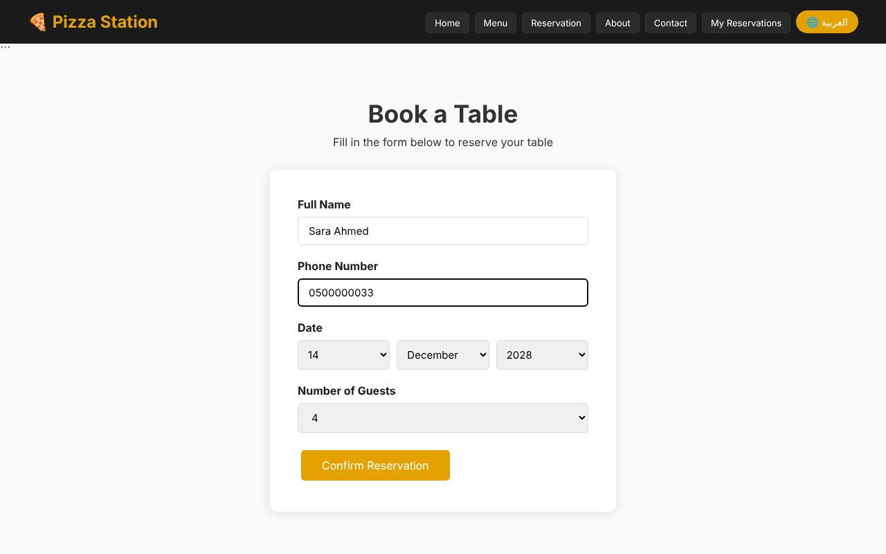
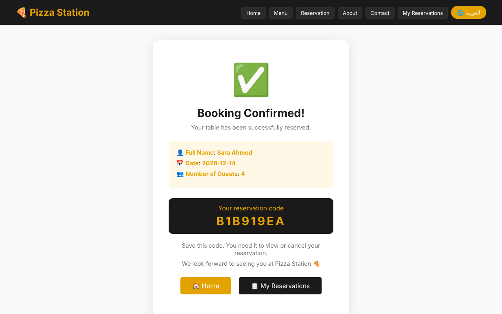
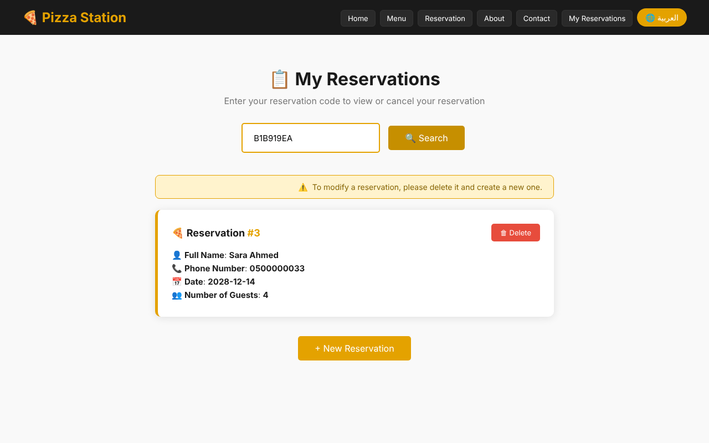
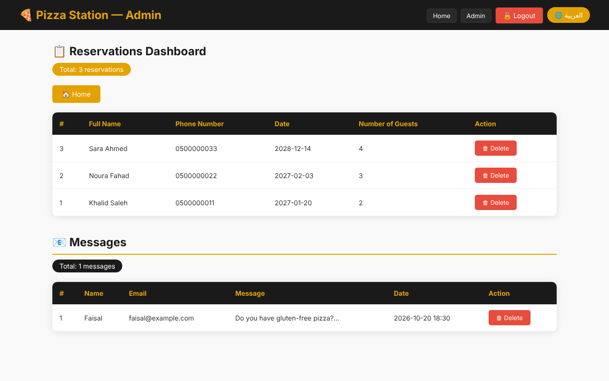
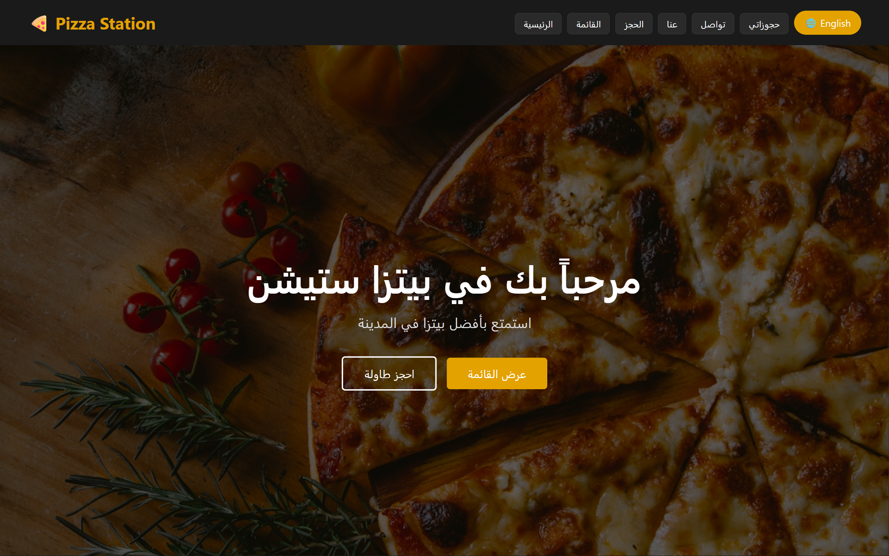
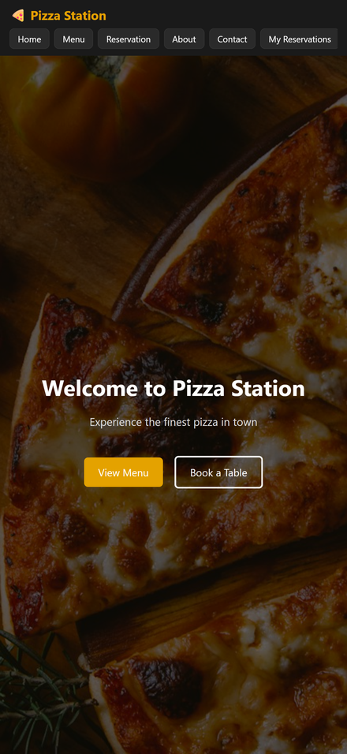

# 🍕 Pizza Station

A bilingual (Arabic / English) restaurant website where customers can browse the menu, book a table, and manage their booking, with a password-protected admin dashboard. Built with Flask and PostgreSQL, deployed on Render, and tracked with Google Analytics 4.

**Live demo:** https://pizza-station-unzn.onrender.com
*(Free hosting: the first visit after a quiet period can take up to a minute to wake the server.)*

Group project for the **Web Data Analysis** course at Umm Al-Qura University. I did the technical and analytics work: building and deploying the site, setting up Google Analytics 4, and analyzing the visitor data behind the course report.



## Features

- **Menu** with pizza, sides, drinks, and desserts, filterable by category.
- **Table reservations** with checks on both the browser and the server (valid Saudi phone number, no past dates, 1–20 guests, no double booking on the same day).
- **Private reservation code:** every booking gets a random 8-character code. The code, not the phone number, is needed to view or cancel a booking.
- **Contact form** that stores messages in the database.
- **Admin dashboard** to view and delete reservations and messages. Login expires after 30 minutes.
- **Arabic / English switch** with right-to-left layout, remembered between visits.
- **Responsive design** for phones (87% of real visitors used mobile).
- **Google Analytics 4** with custom events (reservations, contact form, menu filters, language switch).

## Screenshots

| Reservation form | Booking code |
|---|---|
|  |  |

| My reservation | Admin dashboard |
|---|---|
|  |  |

| Arabic version | Mobile |
|---|---|
|  |  |

*Screenshots use made-up sample data.*

## Tech stack

| Part | Tools |
|---|---|
| Backend | Python, Flask, Gunicorn |
| Database | PostgreSQL (Supabase) |
| Frontend | HTML, CSS, vanilla JavaScript |
| Hosting | Render (web service), Supabase (database) |
| Analytics | Google Analytics 4 |
| Automation | GitHub Actions (keep-alive job) |

## Analytics results

The site ran for about three weeks with real visitors, most of them classmates. From the GA4 data:

- 45 users, 388 page views, and 1,245 events.
- The reservation page had the lowest bounce rate (2.9%).
- 87% of visitors used a mobile device, which led to mobile layout improvements.
- The final report gave 7 data-based recommendations.

📄 Short summary I wrote myself from the GA4 data: [analytics-summary.pdf](docs/analytics-summary.pdf)

## Security

Things this project does on purpose:

- Secrets (`DATABASE_URL`, `ADMIN_PASSWORD`, `SECRET_KEY`) come only from environment variables. The app refuses to start without them.
- All SQL queries use parameters (`%s`), which protects against SQL injection.
- Deleting data needs a `POST` request, never a plain link. Customers can cancel only with their private code; only a logged-in admin can delete anything else.
- The session cookie is `HttpOnly`, `SameSite=Lax`, and `Secure` in production.
- The admin password is compared in constant time (`hmac.compare_digest`).

## Run it locally

You need Python 3 and a PostgreSQL database (a free Supabase project works).

```bash
git clone https://github.com/Osama-F-Alharbi/pizza-station.git
cd pizza-station
python -m venv venv
venv\Scripts\activate        # Windows (macOS/Linux: source venv/bin/activate)
pip install -r requirements.txt
```

Copy `.env.example` to `.env` and fill in your own values. Flask reads `.env` automatically when `python-dotenv` is installed:

```bash
pip install python-dotenv
flask --app app run
```

Add `FLASK_DEBUG=1` to your `.env` for local development (it also lets the login cookie work over plain `http`).

Open http://127.0.0.1:5000. The tables are created automatically on first start.

## Project structure

```
pizza-station/
├── app.py                  # Flask routes, database access, validation
├── requirements.txt
├── Procfile                # Start command for Render (gunicorn)
├── .env.example            # Names of the required environment variables
├── templates/              # HTML pages (Jinja2)
├── static/
│   ├── style.css
│   ├── script.js           # Translations, form checks, GA4 events
│   ├── favicon.svg
│   └── images/
├── docs/
│   ├── analytics-summary.pdf
│   └── screenshots/
└── .github/workflows/
    └── keep-alive.yml      # Visits /health every 3 days
```

## Keeping the free services awake

Free Supabase projects pause after a week without database activity, and free Render services sleep after 15 minutes. The GitHub Actions job in `.github/workflows/keep-alive.yml` calls `/health` every 3 days; that page runs a small database query. GitHub turns off scheduled jobs in repositories with no activity for 60 days, so it may need to be turned back on from the **Actions** tab.

## Known limitations

- There is no limit on how many reservation codes someone can try. With about 4 billion possible codes this is fine for a course project, but a real site would add rate limiting.
- The admin area uses one shared password instead of user accounts.
- Dates are stored as text in `YYYY-MM-DD` format; a real system would use a `DATE` column.
- Menu and drink images were collected from the web for educational use only.

## How this project was built

This was a group course project. I did the technical work, and I built it with the help of AI coding assistants. I want to be clear about what that means:

- **With AI help:** the website code and the written analytics report.
- **My own work:** planning the features and pages, deploying the site on Render with a Supabase database, setting up Google Analytics 4, and reading the GA4 data myself to understand the results behind the report.
- **Written by me:** the short analytics summary in `docs/analytics-summary.pdf`.
- **Security clean-up I did by hand:** removed hard-coded passwords from the code, turned off debug mode, moved database setup so it runs once at startup, rotated every leaked secret, and moved the project to a clean repository with no secrets in its history.

The later improvements (reservation codes, server-side checks, admin hardening) were also written with AI help, and I reviewed and tested each one on the live site.
